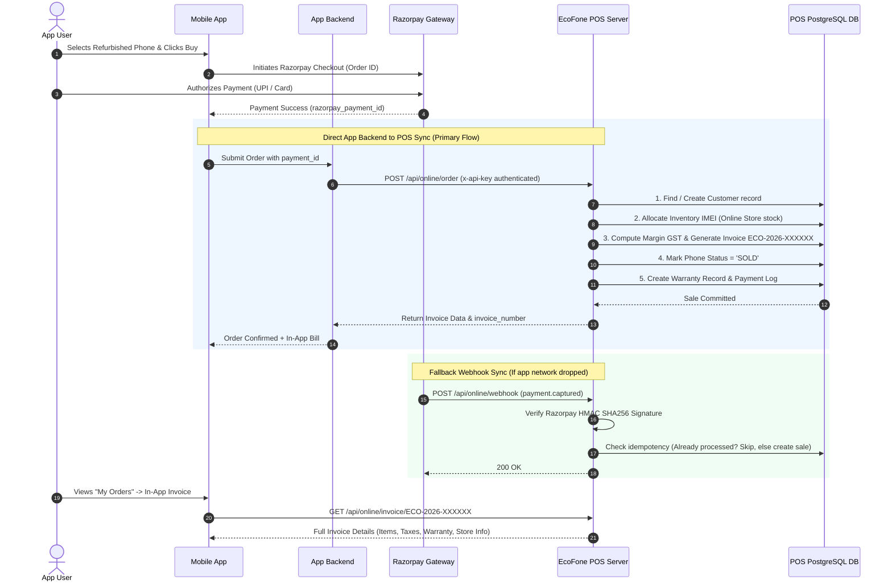

# 📱 EcoFone Mobile App & Razorpay POS Integration Architecture

Comprehensive technical documentation for integrating the **EcoFone Customer Mobile App** (Buy refurbished phones with Razorpay) with the **EcoFone Billing POS System** for automated in-app invoice generation, real-time inventory deduction, warranty tracking, and financial reconciliation.

---

## 📑 Table of Contents
1. [Executive Summary & High-Level Architecture](#1-executive-summary--high-level-architecture)
2. [End-to-End Workflow & Sequence Diagram](#2-end-to-end-workflow--sequence-diagram)
3. [Prerequisites & System Configuration](#3-prerequisites--system-configuration)
4. [Environment Variables](#4-environment-variables)
5. [Complete API Specifications](#5-complete-api-specifications)
   - [5.1. Create Online Order (`POST /api/online/order`)](#51-create-online-order-post-apionlineorder)
   - [5.2. Razorpay Webhook Handler (`POST /api/online/webhook`)](#52-razorpay-webhook-handler-post-apionlinewebhook)
   - [5.3. Public In-App Invoice API (`GET /api/online/invoice/:invoiceNumber`)](#53-public-in-app-invoice-api-get-apionlineinvoiceinvoicenumber)
   - [5.4. Admin Online Orders List (`GET /api/online/orders`)](#54-admin-online-orders-list-get-apionlineorders)
   - [5.5. Admin Razorpay Reconciliation (`GET /api/online/reconcile`)](#55-admin-razorpay-reconciliation-get-apionlinereconcile)
6. [Inventory Allocation & GST Margin Scheme](#6-inventory-allocation--gst-margin-scheme)
7. [Razorpay Dashboard & Checkout Setup Guide](#7-razorpay-dashboard--checkout-setup-guide)
8. [Mobile App Integration Code Examples (Flutter / React Native / Node.js)](#8-mobile-app-integration-code-examples)
9. [POS Admin Panel: Online Orders & Reconciliation Guide](#9-pos-admin-panel-online-orders--reconciliation-guide)
10. [Troubleshooting & FAQ](#10-troubleshooting--faq)

---

## 1. Executive Summary & High-Level Architecture

When a customer purchases a phone in the EcoFone mobile app:
1. **Payment**: The customer completes the transaction securely via **Razorpay** (UPI, Cards, NetBanking, EMI).
2. **Instant Sync**: Immediately upon payment confirmation, the App backend calls the EcoFone POS API (or Razorpay triggers a webhook).
3. **POS Automation**:
   - Customer profile is created or updated in POS.
   - Specific phone IMEI is allocated (or auto-allocated via FIFO from the Online Store inventory).
   - Phone stock is marked as `SOLD`.
   - GST is computed using the refurbished **Margin Scheme** (tax on profit margin, not full device cost).
   - Warranty card (e.g., 6 months warranty) is automatically created and activated.
   - Official sequential invoice (`ECO-2026-XXXXXX`) is generated.
4. **Instant In-App Bill**: The app receives the full invoice details and URL so the customer can view, download, or share their PDF tax bill right inside the app.
5. **Reconciliation**: Accounts and store managers can verify payment IDs, fees, and settlements in the POS **Online Orders & Reconciliation** dashboard.

---

## 2. End-to-End Workflow & Sequence Diagram



---

## 3. Prerequisites & System Configuration

Before launching online orders in production, ensure the following POS entities exist in the database:

### A. Online Store Setup
Create a dedicated virtual store in **Stores** section:
- **Store Name**: `EcoFone Online Store`
- **Store Code**: `ECO-ONLINE` (matches `ONLINE_STORE_CODE`)
- **City / State**: Default headquarters city/state (used for IGST vs CGST/SGST calculations)
- **Status**: `Active`

> **Note**: Phones intended to be sold online should be stocked in or transferred to this `ECO-ONLINE` store.

### B. System Bot Employee
Create an active system user in **Employees** section:
- **Username**: `online_system` (matches `ONLINE_EMPLOYEE_USERNAME`)
- **Full Name**: `Online System Bot`
- **Role**: `EMPLOYEE`
- **Assigned Store**: `EcoFone Online Store`

---

## 4. Environment Variables

Add the following keys to `server/.env`:

```env
# EcoFone Online App Integration
ONLINE_STORE_CODE="ECO-ONLINE"
ONLINE_API_KEY="ecofone_live_sec_99a81f3b8902c4"
ONLINE_EMPLOYEE_USERNAME="online_system"

# Razorpay Webhook Secret (obtained from Razorpay Dashboard -> Webhooks)
RAZORPAY_WEBHOOK_SECRET="whsec_ecofone_razorpay_live_2026"
```

---

## 5. Complete API Specifications

### 5.1. Create Online Order (`POST /api/online/order`)
Called by the App Backend immediately after customer completes payment.

- **URL**: `https://your-pos-domain.com/api/online/order`
- **Method**: `POST`
- **Headers**:
  ```http
  Content-Type: application/json
  x-api-key: ecofone_live_sec_99a81f3b8902c4
  ```

#### Request Body
```json
{
  "order_id": "APP-ORD-10829",
  "channel": "APP",
  "customer": {
    "full_name": "Rahul Sharma",
    "phone": "9876543210",
    "email": "rahul.sharma@gmail.com",
    "address": "Flat 402, Sunshine Heights, MG Road",
    "city": "Indore",
    "state": "Madhya Pradesh",
    "pincode": "452001"
  },
  "item": {
    "brand": "Apple",
    "model": "iPhone 13",
    "storage": "128GB",
    "color": "Midnight Black",
    "grade": "Like New",
    "imei": "356789101234567"
  },
  "payment": {
    "razorpay_payment_id": "pay_O7xKwXv983LmQ1",
    "razorpay_order_id": "order_O7xK3Yy456AbCd",
    "amount": 38999.00
  }
}
```

> **Stock Allocation Options in `item`**:
> 1. **Option A (Specific IMEI)**: Provide `"imei": "..."` to sell an exact serialized phone.
> 2. **Option B (Specific Phone ID)**: Provide `"phone_id": 142` to sell by inventory database ID.
> 3. **Option C (Auto FIFO)**: Leave `imei` and `phone_id` blank, provide `brand`, `model`, `storage`, and `grade`. The system will automatically select the oldest matching unit from `ECO-ONLINE` inventory!

#### Success Response (`201 Created`)
```json
{
  "success": true,
  "message": "Online order created and invoice generated successfully.",
  "data": {
    "sale_id": 412,
    "invoice_number": "ECO-2026-000452",
    "sale_number": "SL-2026-000452",
    "grand_total": 38999,
    "phone": {
      "brand": "Apple",
      "model": "iPhone 13",
      "imei1": "356789101234567",
      "conditionGrade": "Like New"
    },
    "invoice_url": "/api/online/invoice/ECO-2026-000452",
    "already_existed": false
  }
}
```

---

### 5.2. Razorpay Webhook Handler (`POST /api/online/webhook`)
Handles `payment.captured` events directly from Razorpay as an automated fallback.

- **URL**: `https://your-pos-domain.com/api/online/webhook`
- **Method**: `POST`
- **Headers**:
  ```http
  Content-Type: application/json
  x-razorpay-signature: <hex_hmac_sha256>
  ```
- **Security**: Verifies payload using HMAC SHA256 against `RAZORPAY_WEBHOOK_SECRET`.
- **Idempotency**: If the order was already recorded via direct API call, it safely ignores duplicate processing.

---

### 5.3. Public In-App Invoice API (`GET /api/online/invoice/:invoiceNumber`)
Used by the mobile app to display full invoice details in-app without requiring staff login tokens.

- **URL**: `https://your-pos-domain.com/api/online/invoice/ECO-2026-000452`
- **Method**: `GET`
- **Authentication**: None (guarded by sequential invoice ID format and restricted to online sales).

#### Success Response (`200 OK`)
```json
{
  "success": true,
  "sale": {
    "invoice_number": "ECO-2026-000452",
    "sale_date": "2026-10-14T05:30:00.000Z",
    "grand_total": 38999,
    "subtotal": 38999,
    "taxable_amount": 1904.76,
    "cgst": 47.62,
    "sgst": 47.62,
    "igst": 0,
    "total_tax": 95.24,
    "payment_status": "PAID",
    "customer_name": "Rahul Sharma",
    "customer_phone": "9876543210",
    "store_name": "EcoFone Online Store",
    "store_gstin": "23AAAAA0000A1Z5"
  },
  "items": [
    {
      "brand": "Apple",
      "model": "iPhone 13",
      "imei1": "356789101234567",
      "condition_grade": "Like New",
      "selling_price": 38999,
      "warranty_period_months": 6,
      "warranty_expiry": "2027-04-14T05:30:00.000Z"
    }
  ],
  "payments": [
    {
      "payment_method": "RAZORPAY",
      "amount": 38999,
      "reference_number": "pay_O7xKwXv983LmQ1",
      "payment_date": "2026-10-14T05:30:00.000Z"
    }
  ]
}
```

---

### 5.4. Admin Online Orders List (`GET /api/online/orders`)
- **URL**: `https://your-pos-domain.com/api/online/orders?page=1&limit=50&search=9876543210`
- **Headers**: `Authorization: Bearer <ADMIN_JWT_TOKEN>`
- **Response**: Paginated list of online sales with Razorpay IDs, customer details, and invoice links.

---

### 5.5. Admin Razorpay Reconciliation (`GET /api/online/reconcile`)
- **URL**: `https://your-pos-domain.com/api/online/reconcile?date_from=2026-10-01&date_to=2026-10-31`
- **Headers**: `Authorization: Bearer <ADMIN_JWT_TOKEN>`
- **Response**:
  ```json
  {
    "success": true,
    "summary": {
      "total_orders": 24,
      "total_collected": 785400,
      "estimated_razorpay_fee": 18535.44,
      "estimated_net_settlement": 766864.56
    },
    "records": [
      {
        "payment_id": "pay_O7xKwXv983LmQ1",
        "invoice_number": "ECO-2026-000452",
        "customer_name": "Rahul Sharma",
        "amount": 38999,
        "payment_date": "2026-10-14T05:30:00.000Z",
        "item": "Apple iPhone 13 (356789101234567)"
      }
    ]
  }
  ```

---

## 6. Inventory Allocation & GST Margin Scheme

### Indian GST Rule for Second-Hand / Refurbished Goods (Margin Scheme)
Under **Rule 32(5) of CGST Rules, 2017**:
- When a taxable person sells second-hand/refurbished goods, GST is levied **only on the margin** (Selling Price minus Purchase/Refurbishment Cost).
- If Selling Price is less than or equal to Purchase Cost, the taxable value is treated as **Nil**.

$$\text{Taxable Margin} = \frac{\text{Selling Price} - \text{Total Cost}}{1 + (\text{Tax Rate} / 100)}$$

$$\text{Total GST} = \text{Taxable Margin} \times \frac{\text{Tax Rate}}{100}$$

- **Intra-state (same state as store)**: CGST = 50%, SGST = 50%
- **Inter-state (different state)**: IGST = 100%

The EcoFone POS backend computes this margin calculation automatically for all online orders.

---

## 7. Razorpay Dashboard & Checkout Setup Guide

### Step 1: Pass Metadata in Razorpay Order Creation
When creating an order via Razorpay API from the Mobile App / App Backend, include metadata in the `notes` field:

```javascript
const razorpayOrder = await razorpay.orders.create({
  amount: 3899900, // in paise
  currency: "INR",
  receipt: "APP-ORD-10829",
  notes: {
    customer_name: "Rahul Sharma",
    customer_phone: "9876543210",
    customer_email: "rahul.sharma@gmail.com",
    customer_address: "Flat 402, MG Road",
    customer_city: "Indore",
    customer_state: "Madhya Pradesh",
    customer_pincode: "452001",
    brand: "Apple",
    model: "iPhone 13",
    storage: "128GB",
    color: "Midnight Black",
    grade: "Like New",
    imei: "356789101234567" // optional if auto-FIFO
  }
});
```

### Step 2: Configure Webhook in Razorpay Dashboard
1. Go to **Razorpay Dashboard** → **Settings** → **Webhooks**.
2. Click **+ Add New Webhook**.
3. **Webhook URL**: `https://your-pos-domain.com/api/online/webhook`
4. **Secret**: Enter a secure random string (save in `server/.env` as `RAZORPAY_WEBHOOK_SECRET`).
5. **Alert Email**: Enter your operations/tech email.
6. **Active Events**: Select **`payment.captured`**.
7. Click **Create Webhook**.

---

## 8. Mobile App Integration Code Examples

### A. React Native / Node.js
```javascript
// Function called in mobile app after Razorpay checkout returns payment_id
async function syncOrderToPos(paymentResponse, orderDetails, customerDetails) {
  try {
    const response = await fetch('https://your-pos-domain.com/api/online/order', {
      method: 'POST',
      headers: {
        'Content-Type': 'application/json',
        'x-api-key': 'ecofone_live_sec_99a81f3b8902c4'
      },
      body: JSON.stringify({
        order_id: orderDetails.appOrderId,
        channel: 'APP',
        customer: {
          full_name: customerDetails.name,
          phone: customerDetails.phone,
          email: customerDetails.email,
          address: customerDetails.address,
          city: customerDetails.city,
          state: customerDetails.state,
          pincode: customerDetails.pincode
        },
        item: {
          brand: orderDetails.brand,
          model: orderDetails.model,
          storage: orderDetails.storage,
          color: orderDetails.color,
          grade: orderDetails.grade,
          imei: orderDetails.imei // or omit for auto-FIFO
        },
        payment: {
          razorpay_payment_id: paymentResponse.razorpay_payment_id,
          razorpay_order_id: paymentResponse.razorpay_order_id,
          amount: orderDetails.totalAmount
        }
      })
    });

    const data = await response.json();
    if (data.success) {
      console.log('POS Invoice Generated:', data.data.invoice_number);
      // Navigate customer to in-app invoice screen
      return data.data;
    } else {
      console.error('POS sync error:', data.message);
    }
  } catch (err) {
    console.error('Network error syncing with POS:', err);
  }
}
```

### B. Fetching In-App Invoice (Flutter / Dart)
```dart
Future<Map<String, dynamic>?> fetchInvoiceDetails(String invoiceNumber) async {
  final url = Uri.parse('https://your-pos-domain.com/api/online/invoice/$invoiceNumber');
  final response = await http.get(url);

  if (response.statusCode == 200) {
    final body = jsonDecode(response.body);
    if (body['success'] == true) {
      return body;
    }
  }
  return null;
}
```

---

## 9. POS Admin Panel: Online Orders & Reconciliation Guide

Inside the POS Admin Dashboard:
1. Navigate to **Online Orders & App** in the left sidebar (`/admin/online-orders`).
2. Two tabs are available:
   - **📦 All Online Orders**:
     - Live feed of all mobile app / online sales.
     - Search by invoice number, customer name, or phone.
     - Click the **Eye icon** on any row to open the full POS thermal/tax invoice modal with instant print or download capabilities.
   - **🔄 Razorpay Reconciliation**:
     - Real-time ledger showing:
       - **Total Online Orders** count
       - **Total Collected (Razorpay)**
       - **Estimated Razorpay Gateway Fees** (~2.36%)
       - **Estimated Net Bank Settlement**
     - Row-by-row match badge verifying that every single Razorpay Payment ID has a corresponding official POS invoice.

---

## 10. Troubleshooting & FAQ

#### Q1: What happens if the customer's phone network disconnects right after Razorpay payment?
> **Answer**: Even if the customer closes the app, Razorpay sends the background webhook to `/api/online/webhook`. The POS backend automatically creates the customer, deducts inventory, and generates the invoice. When the user reopens the app, their order history will show the invoice number.

#### Q2: What if both the App backend and Webhook call the POS simultaneously?
> **Answer**: Built-in idempotency ensures that the Razorpay `payment_id` is unique. Whichever arrives first commits the transaction; the second call simply returns the existing invoice without creating duplicate sales or deducting inventory twice.

#### Q3: What if the selected phone model is out of stock in `ECO-ONLINE` store?
> **Answer**: The endpoint returns an explicit HTTP 400 with message `No available [Brand Model Storage Grade] found in online store stock.` Staff can use the POS **Stock Transfers** module to transfer units from physical retail stores to the online store.

---
*EcoFone POS System — Luxury within reach.*
